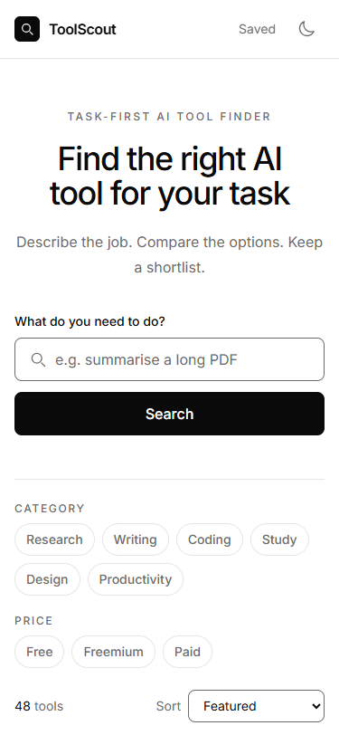
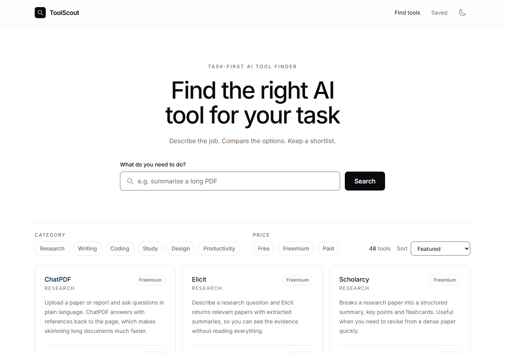
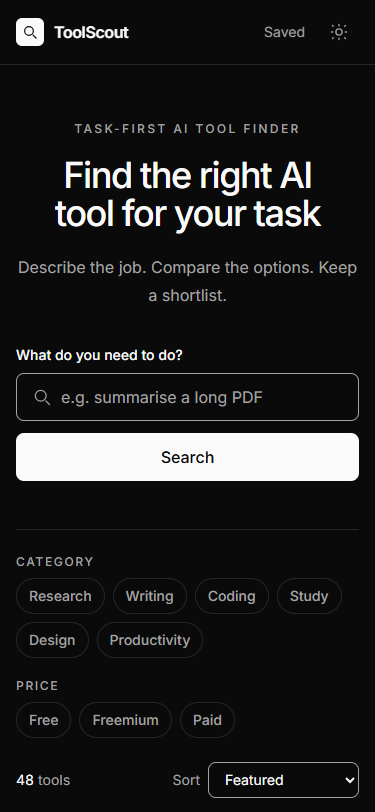
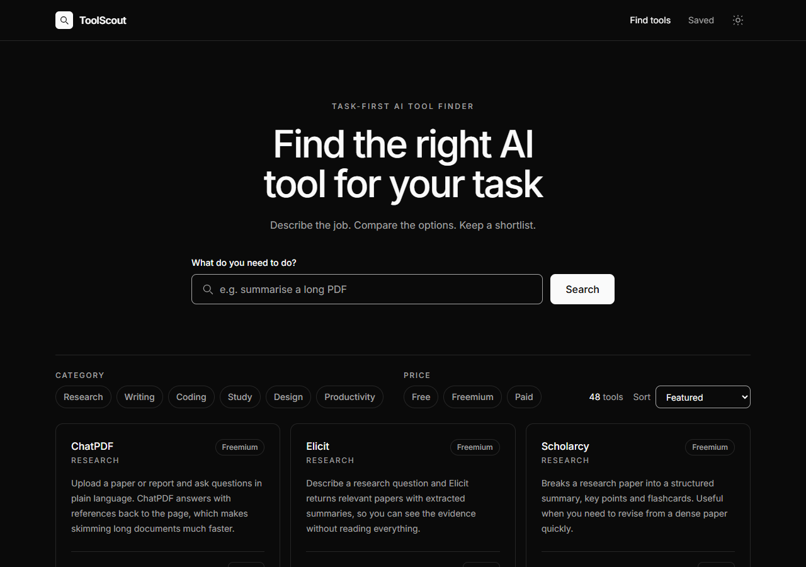

# ToolScout

ToolScout helps you find an AI tool for one job. You type the task you need to do.
The app shows tools that fit. You can filter the list, compare tools side by side and
save a shortlist.

Live site: <https://toolscoutt.netlify.app/>

## The problem

Most AI tool directories list thousands of products. The listings are written like adverts.
It is hard to tell which tool is good for one specific job, which ones are free, and which
ones are worth a second look.

ToolScout starts with the task instead. It shows a short, readable list. It lets you compare
the final two or three options and keep the ones you like.

## Who it is for

Students and early-career researchers. They often have one concrete task, such as
summarising papers, transcribing interviews or cleaning survey data. They do not want to
research the whole market first.

## Core flow

    search by task  ->  filter the list  ->  compare 2-3 tools  ->  read a tool page  ->  save it

## Screens

| Path | Screen | What you can do |
|---|---|---|
| `/` | Find tools | Search by task, filter by category and price, sort, save |
| `/tool/:id` | Tool page | Read the full entry, visit the site, save it |
| `/saved` | Shortlist | See saved tools, remove them, pick tools to compare |
| `/compare?ids=a,b` | Compare | Compare two or three tools in a table |
| anything else | 404 | Get a way back to the finder |

Every path is a real URL. You can open it directly, bookmark it or send it to
someone. Netlify sends `index.html` for unknown paths so deep links work in production.

## Try it

The live site is built and hosted on Netlify:
<https://toolscoutt.netlify.app/>

## Run it on your computer

You need Node.js 20.19 or newer. Then run:

    npm install
    npm run dev:full

Open the URL the dev server prints. It is usually <http://localhost:5173>.
`dev:full` starts two things at once:

- the dev server, which serves the app
- JSON Server, a small fake API on port 3001 that serves the tool data

If you prefer two terminals, run `npm run mock` in one and `npm run dev` in the other.

### Scripts

| Command | What it does |
|---|---|
| `npm run dev:full` | Runs the fake API and the dev server together |
| `npm run dev` | Runs the dev server only. You need the API running too |
| `npm run mock` | Runs the fake API on port 3001 |
| `npm run build` | Builds the production site into `dist/` |
| `npm run preview` | Serves the production build locally |
| `npm run test` | Runs the Vitest tests |
| `npm run check:app` | Drives the built site in Chrome. Needs `npm run preview` running and Chrome installed |
| `npm run check:a11y` | Runs axe on every screen in light and dark mode. Same requirements |

### If port 3001 is busy

Stop the process that is using it, then start again:

    Get-NetTCPConnection -LocalPort 3001 -State Listen | ForEach-Object { Stop-Process -Id $_.OwningProcess -Force }

## How it works

1. The app asks the data endpoint for the list of tools.
2. While it waits, it shows six grey placeholder cards.
3. If the request fails, it shows an error panel with a Try again button.
4. When the list arrives, you can type a task. The list updates on every keystroke.
   It looks in the tool name, description, tags and tasks.
5. Category and price chips narrow the list. Chips can be combined.
6. Sort changes the order: Featured, Name or Price (free first).
7. Save adds a tool to the shortlist. The header and footer show the count.
8. The shortlist is kept in `localStorage`, so it is still there after a reload.
   It stays in one browser because there are no accounts.
9. On the shortlist page you can tick two or three tools and open the compare page.
   The selection is in the URL, so the comparison can be bookmarked or shared.
10. If nothing matches a search, an empty state appears with a Clear filters button.

## Screenshots

| Mobile (375px) | Desktop (1280px) |
|---|---|
|  |  |
|  |  |

## Decisions and why

This section explains each choice in plain words. It also says what the choice costs.

| Decision | Why | Cost or risk |
|---|---|---|
| **Vue 3 + Vite** | I know Vue best. The component model fits a screen made of repeated cards. Vite starts quickly and makes small builds. | New tools in this stack change often. I keep the versions pinned in `package-lock.json`. |
| **Tailwind CSS** | Styles sit next to the markup they style. Responsive rules are easy to see and change. | Class lists in markup are long. |
| **Black-and-white theme** | A monochrome page is calmer and makes the tools the focus. It matches the simple, classy references I was given. | Colour can no longer mark price or status, so labels and icons have to carry that meaning. |
| **Vue Router** | Each screen gets its own URL. Links can be shared and the back button works. | The host must send `index.html` for unknown paths. Netlify does this with one redirect rule. |
| **Pinia for the shortlist** | The shortlist is used on several screens. One shared store is simpler than passing data through every component. | One more dependency, and one more concept to learn. |
| **localStorage for the shortlist** | There is no login and no server to store data. The browser can remember the list for next time. | The list stays on one browser and one device. Clearing site data removes it. |
| **Compare selection in the URL** | A link with `?ids=a,b` can be refreshed, bookmarked and shared. No extra store is needed. | Only the ids are saved. If a tool leaves the dataset, its column disappears. |
| **Curated JSON dataset** | There is no free public API that lists AI tools with the fields I need. I can control the data and keep it honest. | The data is not live. It can go stale. |
| **JSON Server in development, static file in production** | Development uses a real HTTP request. The live site has no server to run, so it needs a plain file. | The two paths can differ. The production build copies the same file, so the shapes match. |
| **Small local UI components instead of shadcn/ui** | The mentor suggested shadcn/ui. That library is for React. Its Vue port is shadcn-vue, but adding a component library in the last week adds risk and code I do not fully know. A few local components give the same consistency. | I write the variants myself. There are fewer ready-made parts. |
| **Vitest + Vue Test Utils** | They use the same Vite setup. Tests can render components and click buttons the way a user would. | Tests need a browser-like environment, so the config includes jsdom. |
| **Netlify** | It builds from GitHub for free and supports the redirect rule a single-page app needs. | Deploys depend on the Netlify build service. |

## Project structure

    data/
      tools.json        # the 48-tool dataset
    public/api/         # generated copy of the data (not committed)
    scripts/
      sync-data.mjs     # copies the data for the production build
      check-app.mjs     # keyboard, routing and layout check in Chrome
    src/
      components/
        ui/             # Button, Badge, Card, Input
        layout/         # AppHeader, AppFooter
        tools/          # search, filters, cards and state panels
      composables/      # useTools, useFilters, useTheme
      router/           # routes, page titles and focus
      services/         # tools.js: the only file that fetches data
      stores/           # the shortlist store
      views/            # one file per route
      App.vue           # page shell: header, main, footer
      main.js           # starts Vue, Pinia and the router
      style.css         # Tailwind entry and base styles
    tests/              # Vitest tests
    docs/               # planning notes, reports and records

The full component map is in [`docs/component-map.md`](docs/component-map.md).

## The data

The dataset is [`data/tools.json`](data/tools.json). It holds 48 tools across six categories,
with 7 to 9 tools in each category.

Each tool has these fields:

| Field | Type | Meaning |
|---|---|---|
| `id` | text | Unique slug. Used in URLs |
| `name` | text | Display name |
| `category` | one of six | Research, Writing, Coding, Study, Design, Productivity |
| `price` | one of three | Free, Freemium or Paid |
| `freeTier` | true/false | Has a usable free tier |
| `studentFriendly` | true/false | Has a free tier or a student discount |
| `pricingNote` | text | A short note about pricing |
| `tagline` | text | One line for cards |
| `description` | text | Two or three sentences for the detail page |
| `tasks` | list of text | The jobs this tool is good for |
| `tags` | list of text | Keywords for search |
| `bestFor` | text | Who gets the most from it |
| `platforms` | list | Web, iOS, Android, Windows, macOS, Linux, browser extension or API |
| `features` | list of text | Points used in the compare table |
| `pros` | list of text | Strengths |
| `limitations` | list of text | Weaknesses |
| `editorScore` | number 0-5 | My own rating |
| `url` | text | The tool's website |
| `updatedAt` | date | When I last checked the entry |

### Development and production data

- **Development:** `npm run mock` serves `data/tools.json` at `http://localhost:3001/tools`.
- **Production:** `npm run build` first copies the dataset to `public/api/tools.json`.
  The live site reads that file. No server is needed.
- `VITE_API_URL` can point the app at another endpoint. Copy [`.env.example`](.env.example)
  to `.env` to use it. `.env` is not committed.

### Two honesty notes

- `editorScore` is my own assessment. It is not scraped review data.
- `studentFriendly` is a manual flag. It is true when a tool has a free tier or an official
  student discount.

### One format rule

The file must stay in the shape `{ "tools": [...] }` and must not start with a BOM
(an invisible marker some editors add). JSON Server v1 rejects a root array and a BOM.

## Accessibility

The app aims to meet WCAG 2.2 level AA. Lighthouse scored the Week 2 site at **0.96**.
The current build scores **1.00** on all five screens, both before and after the
monochrome redesign. The one automated failure was dark-mode label contrast at
3.74:1. That is now at least 6.9:1.

Other changes in the pass:

- a skip link, a visible search label and a visible focus ring
- focus moves to the new page after a route change
- `aria-pressed` on filter, save and theme buttons
- `aria-current="page"` on the active nav link
- live regions for the result count and the empty state
- a real table for the comparison, with row and column headers
- one `h1` per page and a title that matches the page
- a theme that follows the operating system and remembers your choice

`npm run check:app` presses keys in Chrome and checks 20 things, including Tab
order, Enter on filters, focus after removing a compare column and the 320px layout.
All 20 pass.

`npm run check:a11y` runs axe on five screens in both light and dark mode. It finds
0 violations and no console errors. Together the two scripts cover what Lighthouse
cannot: keyboard use, the light theme and the screens that only exist in Week 3.

The full record, including what is still untested, is in
[`docs/accessibility.md`](docs/accessibility.md).

## Tests

    npm run test

There are 4 test files and 13 tests:

- a component render (`Button` in three forms)
- a user interaction (`ToolCard` Save click and saved state)
- data state (`fetchTools` with good data, bad data, an HTTP error and a retry path)
- the shortlist store: toggle, persistence and broken stored data

`npm run check:app` is a separate end-to-end check. It is not part of `npm run test`
because it needs a built site, a preview server and Chrome.

## Docs

- [Component map](docs/component-map.md)
- [Accessibility pass](docs/accessibility.md)
- [Technical reflection](docs/reflection.md)
- [AI use declaration](docs/ai-use.md)
- [Weekly update notes](docs/weekly-updates.md)
- [Idea one-pager](docs/idea-one-pager.md)
- [Work plan](docs/work-plan.md)
- [Key-screen sketch](docs/key-screen-sketch.md)

## Known limitations

- The dataset is static and hand-written. It is not live and it can go stale.
- `editorScore` is a personal opinion, not a survey.
- The shortlist lives in one browser. It does not follow you to another device,
  because there are no accounts.
- Search and filters are not in the URL. They reset when you leave the home page.
  The compare selection is in the URL.
- The compare view caps the selection at three tools. This keeps the table readable.
- The production build reads a static file. It does not test a real API under load.
- Search is a simple text match. It does not understand synonyms.
- No screen-reader or real-device test has been run yet.

## Glossary

| Term | Plain meaning |
|---|---|
| **API** | A way for one program to ask another for data |
| **axe** | A tool that checks a page for accessibility problems |
| **BOM** | An invisible marker at the start of some text files. It can break JSON parsers |
| **Composable** | A small function in `src/composables/` that holds reusable state or behaviour |
| **Contrast ratio** | A measure of how easy text is to read against its background. WCAG asks for at least 4.5:1 for body text |
| **Deep link** | A URL that opens a specific screen, not just the home page |
| **Design token** | A named value, such as `paper` or `ink`, kept in one place so every component uses the same colour |
| **Emit** | A child component sending an event to its parent |
| **JSON** | A plain text format for structured data |
| **Lighthouse** | A Chrome tool that scores a page on performance, accessibility and more |
| **localStorage** | Built-in browser storage. Data stays after a reload and is not sent to a server |
| **Mock API** | A fake server that returns sample data during development |
| **Pinia** | The official state store for Vue. Holds data that many components need |
| **Prop** | Data passed from a parent component into a child |
| **Query string** | The part of a URL after `?`. In `/compare?ids=a,b` it holds the tools to compare |
| **Route** | A URL pattern matched to a view, such as `/tool/:id` |
| **Single-page app (SPA)** | A site that loads once and swaps screens in the browser without full page reloads |
| **Skip link** | The first link on a page. It jumps keyboard users past the header to the content |
| **Store** | A shared container for state, in this project a Pinia store |
| **Variant** | A named style option on a component, such as `primary` or `ghost` on a button |
| **WCAG** | Web Content Accessibility Guidelines. The standard used for the accessibility pass |

## Licence

MIT. See [LICENSE](LICENSE).
